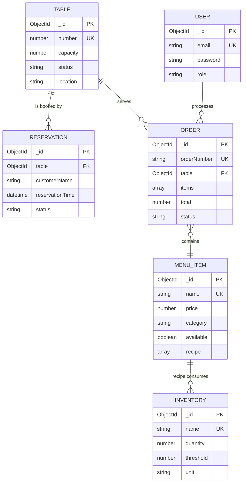
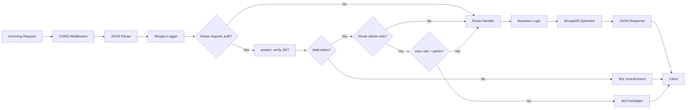
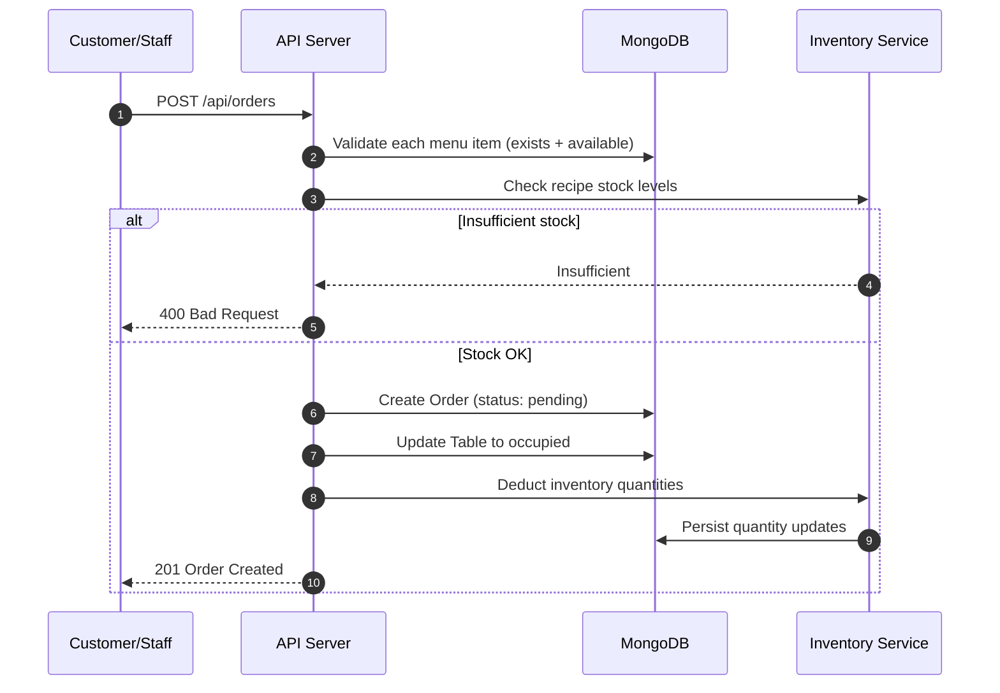
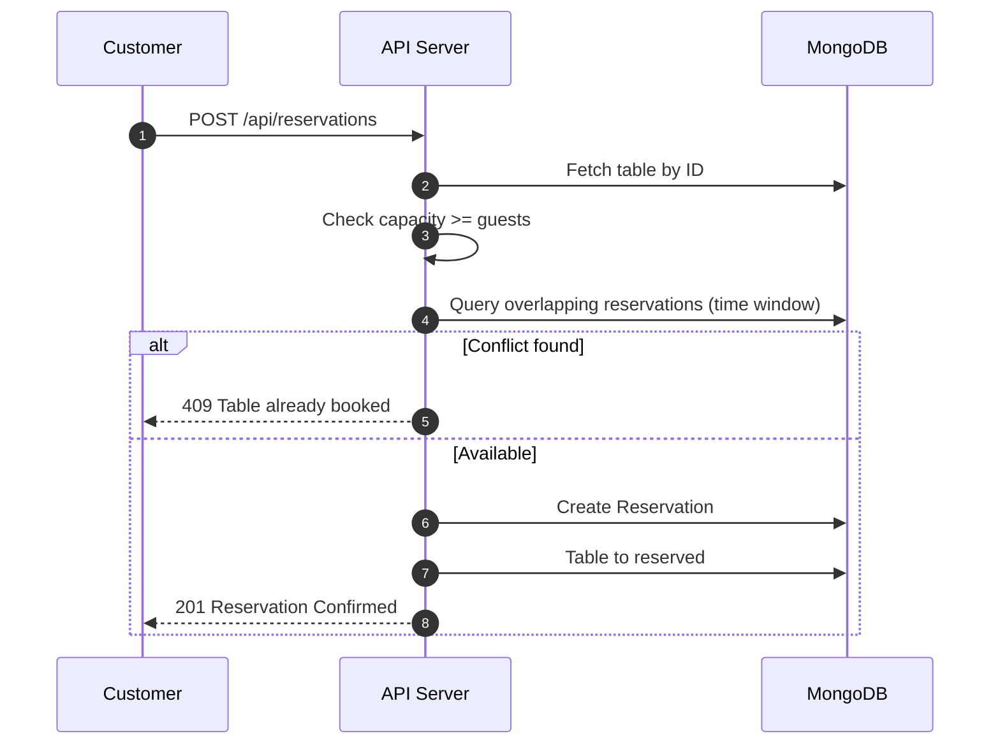
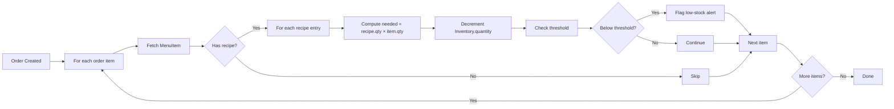
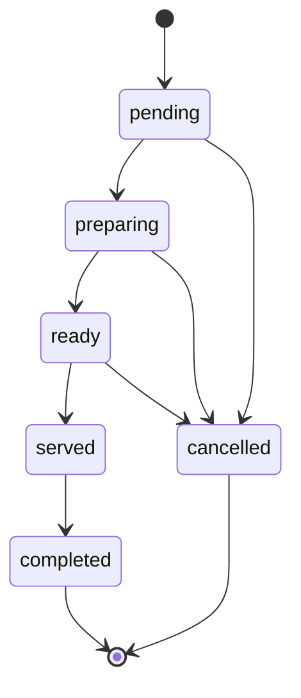
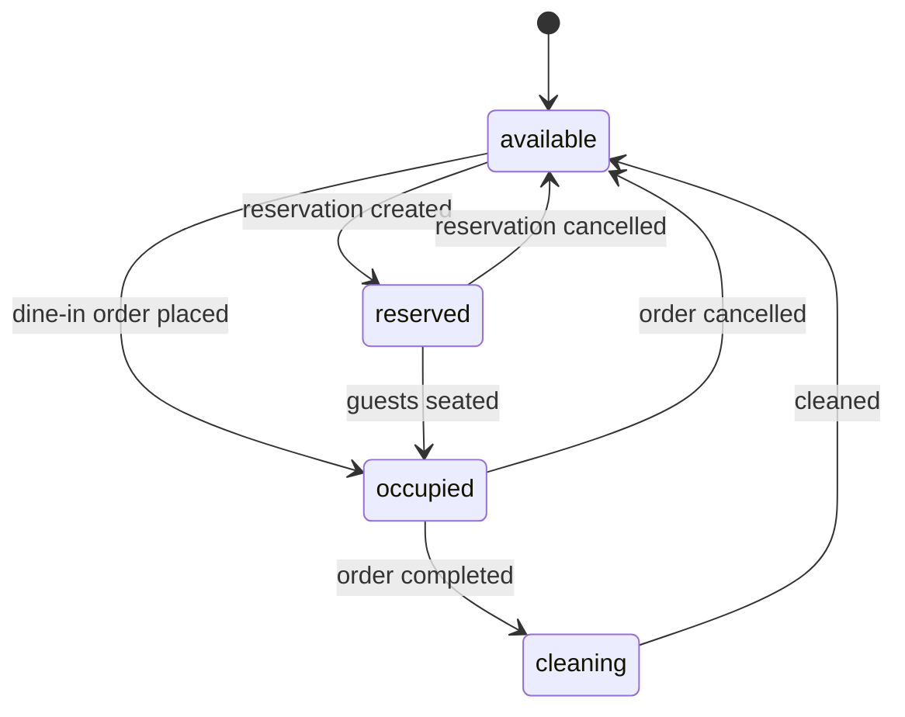
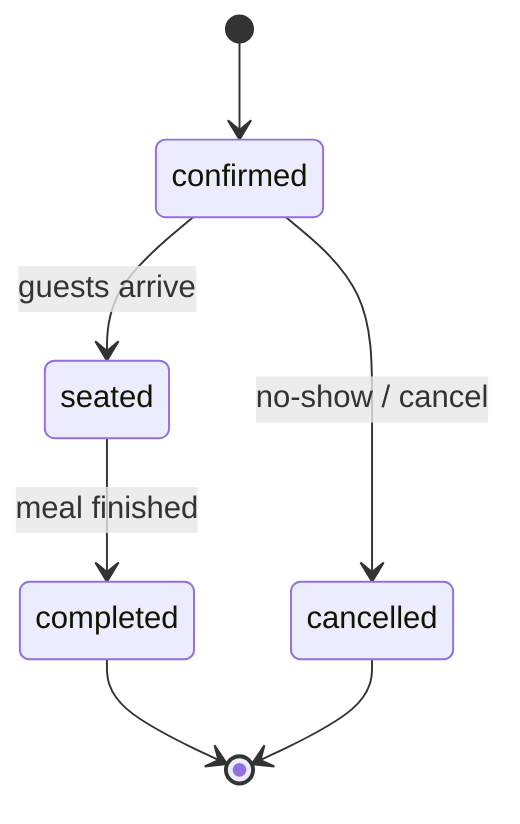
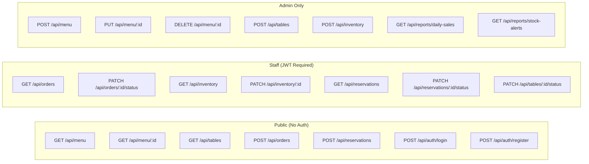
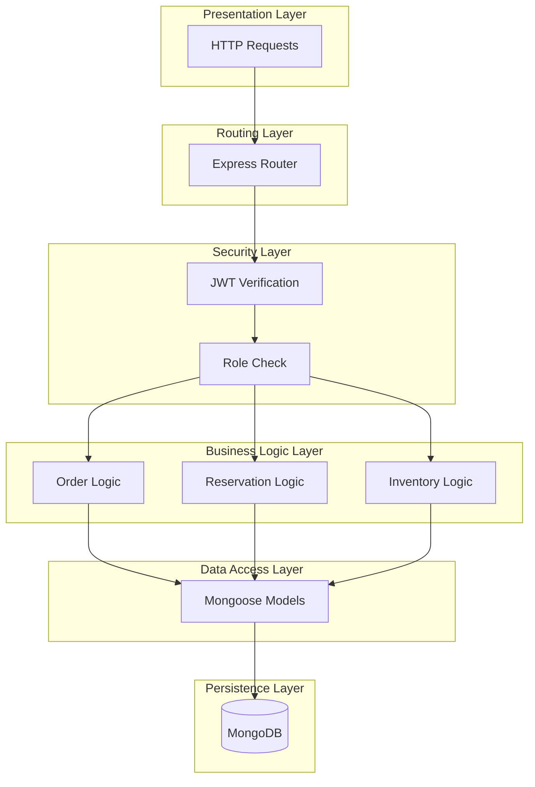

# Restaurant Management System


A full-stack backend system built with Node.js, Express.js, and MongoDB to streamline day-to-day restaurant operations — from taking orders and managing tables to tracking inventory and generating sales reports.

---

## Table of Contents

- [Overview](#overview)
- [Features](#features)
- [System Architecture](#system-architecture)
- [Tech Stack](#tech-stack)
- [Quick Start](#quick-start)
- [API Endpoints](#api-endpoints)
- [Project Structure](#project-structure)
- [Sample Flow](#sample-flow)
- [Future Improvements](#future-improvements)
- [License](#license)

---

## Overview

Running a restaurant means juggling dozens of moving parts at once: customers walking in, tables filling up, orders flowing to the kitchen, and ingredients running low without warning. Manual systems (paper tickets, spreadsheets) break down quickly and cause mistakes that cost money.

This Restaurant Management System (RMS) solves that by providing a single backend that handles the entire lifecycle of restaurant operations through clean, secure REST APIs. It is designed to be the brain behind any restaurant POS, admin dashboard, or customer-facing app.

---

## Features

- **Order Management** — Customers or staff place orders containing multiple menu items. The system validates availability, calculates totals, and tracks each order through its lifecycle.
- **Table Management** — Assign tables to dine-in orders, track real-time status, and prevent double-booking.
- **Reservation System** — Book tables in advance with automatic time-overlap conflict detection.
- **Inventory Auto-Update** — Every menu item stores a recipe. When an order is placed, the system automatically deducts raw ingredients from inventory. Cancellations restore stock.
- **Low-Stock Alerts** — Every inventory item has a threshold. When quantity falls below it, the system raises an alert.
- **Reporting** — Daily sales summaries, top-selling items, order status breakdowns, and stock alerts.
- **Authentication and Roles** — JWT-based login with two roles: `admin` and `staff`. Admin-only routes protect sensitive endpoints.

### Key Design Highlights

| Feature | How It Works |
|---------|--------------|
| Inventory auto-deduction | Each `MenuItem` stores a `recipe` array linking to `Inventory` documents. Placing an order consumes stock atomically. |
| Double-booking prevention | Reservation checks use a time-window overlap query, not just `status === 'available'`. |
| Reversible operations | Order cancellation restores inventory and frees the table. |
| Role-based security | `protect` middleware verifies JWTs; `adminOnly` guards admin routes. |
| Clean architecture | Models, routes, middleware, and helpers are separated for maintainability. |

---

## System Architecture


<summary>ASCII Fallback</summary>

```
┌─────────────────────────────────────────────────────────────────┐
│                        CLIENT LAYER                             │
│   Web UI / Mobile App / Postman                                 │
└──────────────────────────┬──────────────────────────────────────┘
                           │ HTTP + JSON
                           ▼
┌─────────────────────────────────────────────────────────────────┐
│                    EXPRESS.JS API SERVER                        │
│  ┌──────────────────────────────────────────────────────────┐  │
│  │ Middleware: CORS │ JSON Parser │ JWT Auth │ Error Handler│  │
│  └──────────────────────────────────────────────────────────┘  │
│  ┌──────────────────────────────────────────────────────────┐  │
│  │ Routes:                                                  │  │
│  │   /api/auth    /api/menu       /api/tables               │  │
│  │   /api/orders  /api/inventory  /api/reservations         │  │
│  │   /api/reports                                           │  │
│  └──────────────────────────────────────────────────────────┘  │
│  ┌──────────────────────────────────────────────────────────┐  │
│  │ Business Logic:                                          │  │
│  │   • Order Processing         • Inventory Auto-Deduct     │  │
│  │   • Table Availability       • JWT Authentication        │  │
│  └──────────────────────────────────────────────────────────┘  │
└──────────────────────────┬──────────────────────────────────────┘
                           │ Mongoose ODM
                           ▼
┌─────────────────────────────────────────────────────────────────┐
│                     MONGODB DATABASE                            │
│                                                                 │
│   [users] [menu_items] [tables] [reservations] [orders]        │
│                                [inventory]                      │
└─────────────────────────────────────────────────────────────────┘
```

</details>

### 2. Entity Relationship Diagram



<details>
<summary>ASCII Fallback</summary>

```
┌──────────────┐          ┌──────────────────┐
│    USER      │          │    MENU_ITEM     │
├──────────────┤          ├──────────────────┤
│ _id (PK)     │          │ _id (PK)         │
│ email (UK)   │          │ name (UK)        │
│ password     │          │ price            │
│ role         │          │ category         │
└──────┬───────┘          │ available        │
       │                  │ recipe[] ────────┼──┐
       │                  └────────┬─────────┘  │
       │ processes                 │ contains   │ consumes
       │                           │            ▼
┌──────▼───────┐          ┌────────▼─────────┐ ┌──────────────┐
│    ORDER     │          │      TABLE       │ │  INVENTORY   │
├──────────────┤          ├──────────────────┤ ├──────────────┤
│ _id (PK)     │◄────────►│ _id (PK)         │ │ _id (PK)     │
│ orderNumber  │  serves  │ number (UK)      │ │ name (UK)    │
│ table (FK)   │          │ capacity         │ │ quantity     │
│ items[]      │          │ status           │ │ threshold    │
│ total        │          │ location         │ │ unit         │
│ status       │          └────────┬─────────┘ └──────────────┘
└──────────────┘                   │
                                   │ is booked by
                          ┌────────▼─────────┐
                          │   RESERVATION    │
                          ├──────────────────┤
                          │ _id (PK)         │
                          │ table (FK)       │
                          │ customerName     │
                          │ reservationTime  │
                          │ status           │
                          └──────────────────┘
```

</details>

### 3. Request Lifecycle (Middleware Pipeline)



<details>
<summary>ASCII Fallback</summary>

```
Incoming Request
      │
      ▼
┌───────────────┐
│ CORS          │
└───────┬───────┘
        ▼
┌───────────────┐
│ JSON Parser   │
└───────┬───────┘
        ▼
┌───────────────┐
│ Morgan Logger │
└───────┬───────┘
        ▼
   ┌────────────────┐  No   ┌──────────────────┐
   │Requires auth?  ├──────►│  Route Handler   │
   └───────┬────────┘       └────────┬─────────┘
           │ Yes                     │
           ▼                         │
   ┌────────────────┐                │
   │ Verify JWT     │                │
   └───────┬────────┘                │
           ▼                         │
      ┌─────────┐  No                │
      │Valid?   ├──────► 401         │
      └────┬────┘                    │
           │ Yes                     │
           ▼                         │
   ┌────────────────┐  No            │
   │Admin-only?     ├────────────────┤
   └───────┬────────┘                │
           │ Yes                     │
           ▼                         │
      ┌──────────┐  No               │
      │Role=admin├──────► 403        │
      └────┬─────┘                   │
           │ Yes                     │
           ▼                         ▼
        ┌──────────────────────────────┐
        │      Business Logic          │
        └──────────────┬───────────────┘
                       ▼
        ┌──────────────────────────────┐
        │      MongoDB Operation       │
        └──────────────┬───────────────┘
                       ▼
        ┌──────────────────────────────┐
        │      JSON Response           │
        └──────────────┬───────────────┘
                       ▼
                    Client
```

</details>

### 4. Order Processing Flow



<details>
<summary>ASCII Fallback</summary>

```
Customer/Staff          API Server              MongoDB            Inventory
     │                      │                      │                   │
     │  POST /api/orders    │                      │                   │
     ├─────────────────────►│                      │                   │
     │                      │ Validate menu items  │                   │
     │                      ├─────────────────────►│                   │
     │                      │◄─────────────────────┤                   │
     │                      │                      │                   │
     │                      │ Check recipe stock   │                   │
     │                      ├─────────────────────────────────────────►│
     │                      │                      │                   │
     │                      │        ┌─────────────┴───────────┐       │
     │                      │        │  Stock sufficient?      │       │
     │                      │        └──────┬──────────┬───────┘       │
     │                      │               │ No       │ Yes           │
     │                      │◄──────────────┘          │               │
     │  400 Bad Request     │                          │               │
     │◄─────────────────────┤                          │               │
     │                      │                          │               │
     │                      │ Create Order + update    │               │
     │                      ├─────────────────────────►│               │
     │                      │                          │               │
     │                      │ Deduct inventory         │               │
     │                      ├─────────────────────────────────────────►│
     │                      │                          │   Persist     │
     │                      │                          │◄──────────────┤
     │  201 Created         │                          │               │
     │◄─────────────────────┤                          │               │
```

</details>

### 5. Table Reservation Flow



<details>
<summary>ASCII Fallback</summary>

```
Customer                 API Server                 MongoDB
    │                        │                         │
    │ POST /api/reservations │                         │
    ├───────────────────────►│                         │
    │                        │ Fetch table by ID       │
    │                        ├────────────────────────►│
    │                        │◄────────────────────────┤
    │                        │                         │
    │                        │ Check capacity >= guests│
    │                        │ (self)                  │
    │                        │                         │
    │                        │ Query overlapping       │
    │                        │ reservations (window)   │
    │                        ├────────────────────────►│
    │                        │◄────────────────────────┤
    │                        │                         │
    │              ┌─────────┴─────────┐               │
    │              │  Conflict found?  │               │
    │              └────┬──────────┬───┘               │
    │                   │ Yes      │ No                │
    │ 409 Conflict      │          │                   │
    │◄──────────────────┤          │                   │
    │                   │          │ Create Reservation│
    │                   │          ├──────────────────►│
    │                   │          │ Table to reserved │
    │                   │          ├──────────────────►│
    │ 201 Confirmed     │          │                   │
    │◄──────────────────┼──────────┤                   │
```

</details>

### 6. Inventory Auto-Deduction Flow



<details>
<summary>ASCII Fallback</summary>

```
┌───────────────┐
│ Order Created │
└───────┬───────┘
        ▼
┌───────────────────┐
│ For each item:    │◄────────────────┐
└───────┬───────────┘                 │
        ▼                             │
┌───────────────┐                     │
│ Fetch MenuItem│                     │
└───────┬───────┘                     │
        ▼                             │
   ┌──────────┐  No   ┌──────────┐    │
   │ Has recipe?├─────►│  Skip    │    │
   └────┬─────┘       └────┬─────┘    │
        │ Yes              │          │
        ▼                  │          │
┌──────────────────────┐   │          │
│ For each recipe item │   │          │
└───────┬──────────────┘   │          │
        ▼                  │          │
┌───────────────────────┐  │          │
│ needed = qty × qty    │  │          │
└───────┬───────────────┘  │          │
        ▼                  │          │
┌───────────────────────┐  │          │
│ Decrement Inventory   │  │          │
└───────┬───────────────┘  │          │
        ▼                  │          │
   ┌───────────┐   Yes     │          │
   │Below thresh├──────────┤          │
   └────┬──────┘  ┌────────▼──────┐   │
        │ No      │Flag alert     │   │
        ▼         └────────┬──────┘   │
   ┌──────────┐            │          │
   │ Continue │────────────┤          │
   └──────────┘            │          │
                           ▼          │
                   ┌──────────────┐   │
                   │ More items?  ├───┘ Yes
                   └──────┬───────┘
                          │ No
                          ▼
                    ┌──────────┐
                    │   Done   │
                    └──────────┘
```

</details>

### 7. Order Status Lifecycle



<details>
<summary>ASCII Fallback</summary>

```
    ┌─────────┐
    │  START  │
    └────┬────┘
         ▼
    ┌─────────┐   ┌───────────┐   ┌────────┐   ┌────────┐   ┌───────────┐
    │ pending ├──►│ preparing ├──►│  ready ├──►│ served ├──►│ completed │
    └────┬────┘   └─────┬─────┘   └───┬────┘   └────────┘   └─────┬─────┘
         │              │             │                          │
         │              │             │                          ▼
         ▼              ▼             ▼                       ┌───────┐
    ┌──────────────────────────────────────┐                 │  END  │
    │              cancelled               │────────────────►└───────┘
    └──────────────────────────────────────┘
```

</details>

### 8. Table Status Lifecycle



<details>
<summary>ASCII Fallback</summary>

```
         ┌───────────┐
         │ available │◄─────────────────┐
         └─┬───────┬─┘                  │
  reserve  │       │  dine-in order     │ cleaned
           ▼       ▼                    │
      ┌─────────┐ ┌──────────┐    ┌──────────┐
      │reserved │ │ occupied │───►│ cleaning │
      └────┬────┘ └────┬─────┘    └──────────┘
   seated  │           │ cancel
           └──────►    └──────► available
```

</details>

### 9. Reservation Status Lifecycle



<details>
<summary>ASCII Fallback</summary>

```
    ┌───────────┐
    │ confirmed │
    └─┬───────┬─┘
      │       │
seated│       │cancelled
      ▼       ▼
  ┌────────┐ ┌───────────┐
  │ seated │ │ cancelled │
  └───┬────┘ └───────────┘
      │
completed
      ▼
  ┌───────────┐
  │ completed │
  └───────────┘
```

</details>

### 10. API Endpoint Map



<details>
<summary>ASCII Fallback</summary>

```
┌─────────────────────────── PUBLIC ───────────────────────────┐
│  POST /api/auth/login                GET  /api/menu          │
│  POST /api/auth/register             GET  /api/menu/:id      │
│  GET  /api/tables                    POST /api/orders        │
│  POST /api/reservations                                      │
└──────────────────────────────────────────────────────────────┘

┌─────────────────────────── STAFF ────────────────────────────┐
│  GET   /api/orders                   PATCH /api/orders/:id/status │
│  GET   /api/inventory                PATCH /api/inventory/:id     │
│  GET   /api/reservations             PATCH /api/reservations/:id/status │
│  PATCH /api/tables/:id/status                                     │
└──────────────────────────────────────────────────────────────┘

┌─────────────────────────── ADMIN ────────────────────────────┐
│  POST   /api/menu                    PUT    /api/menu/:id    │
│  DELETE /api/menu/:id                POST   /api/tables      │
│  POST   /api/inventory               GET    /api/reports/daily-sales │
│  GET    /api/reports/stock-alerts                            │
└──────────────────────────────────────────────────────────────┘
```

</details>

### 11. Layered Component View



<details>
<summary>ASCII Fallback</summary>

```
┌──────────────────────────────────────┐
│      Presentation Layer              │
│      (HTTP Requests)                 │
└──────────────────┬───────────────────┘
                   ▼
┌──────────────────────────────────────┐
│      Routing Layer                   │
│      (Express Router)                │
└──────────────────┬───────────────────┘
                   ▼
┌──────────────────────────────────────┐
│      Security Layer                  │
│      (JWT + Role Check)              │
└──────────────────┬───────────────────┘
                   ▼
┌──────────────────────────────────────┐
│      Business Logic Layer            │
│      (Orders, Reservations,          │
│       Inventory)                     │
└──────────────────┬───────────────────┘
                   ▼
┌──────────────────────────────────────┐
│      Data Access Layer               │
│      (Mongoose Models)               │
└──────────────────┬───────────────────┘
                   ▼
┌──────────────────────────────────────┐
│      Persistence Layer               │
│      (MongoDB)                       │
└──────────────────────────────────────┘
```

</details>

---

## Tech Stack

| Layer | Technology |
|-------|------------|
| Runtime | Node.js |
| Framework | Express.js |
| Database | MongoDB + Mongoose |
| Auth | JWT + bcrypt |
| Dev Tools | Nodemon, Morgan, CORS, Dotenv |

---

## Quick Start

```bash
# 1. Clone the repository
git clone https://github.com/your-username/restaurant-ms.git
cd restaurant-ms

# 2. Install dependencies
npm install

# 3. Configure environment
cp .env.example .env
# Edit .env and set MONGO_URI and JWT_SECRET

# 4. Seed sample data
npm run seed

# 5. Start the server
npm run dev
```

Server runs at `http://localhost:5000`.

Default admin credentials: `admin@resto.com` / `admin123`

---

## API Endpoints

| Method | Endpoint | Auth | Description |
|--------|----------|------|-------------|
| POST | `/api/auth/register` | Public | Register a new user |
| POST | `/api/auth/login` | Public | Login and receive JWT |
| GET | `/api/menu` | Public | List menu items |
| GET | `/api/menu/:id` | Public | Get menu item details |
| POST | `/api/menu` | Admin | Create menu item |
| PUT | `/api/menu/:id` | Admin | Update menu item |
| DELETE | `/api/menu/:id` | Admin | Delete menu item |
| GET | `/api/tables` | Public | List tables |
| POST | `/api/tables` | Admin | Create table |
| PATCH | `/api/tables/:id/status` | Staff | Update table status |
| POST | `/api/reservations` | Public | Create reservation |
| GET | `/api/reservations` | Staff | List reservations |
| PATCH | `/api/reservations/:id/status` | Staff | Update reservation status |
| POST | `/api/orders` | Public | Place order |
| GET | `/api/orders` | Staff | List orders |
| GET | `/api/orders/:id` | Public | Get order details |
| PATCH | `/api/orders/:id/status` | Staff | Update order status |
| GET | `/api/inventory` | Staff | List inventory |
| GET | `/api/inventory/alerts` | Staff | Get low-stock items |
| POST | `/api/inventory` | Admin | Create inventory item |
| PATCH | `/api/inventory/:id` | Staff | Update inventory quantity |
| GET | `/api/reports/daily-sales` | Admin | Daily sales report |
| GET | `/api/reports/stock-alerts` | Admin | Stock alert report |

---

## Project Structure

```
restaurant-ms/
├── server.js                  Entry point
├── seed.js                    Sample data loader
├── package.json
├── .env
│
├── config/
│   └── db.js                  MongoDB connection
│
├── models/                    Mongoose schemas
│   ├── User.js
│   ├── MenuItem.js            Includes recipe[]
│   ├── Inventory.js
│   ├── Table.js
│   ├── Reservation.js
│   └── Order.js
│
├── routes/                    API endpoints
│   ├── auth.js
│   ├── menu.js
│   ├── tables.js
│   ├── reservations.js
│   ├── orders.js
│   ├── inventory.js
│   └── reports.js
│
├── middleware/
│   └── auth.js                JWT + admin guard
│
└── utils/
    └── helpers.js             Inventory and table logic
```

---

## Sample Flow

### 1. Login as admin

```bash
curl -X POST http://localhost:5000/api/auth/login \
  -H "Content-Type: application/json" \
  -d '{"email":"admin@resto.com","password":"admin123"}'
```

Save the returned `token` as `$T`.

### 2. View menu

```bash
curl http://localhost:5000/api/menu
```

### 3. Check available tables

```bash
curl "http://localhost:5000/api/tables?guests=4"
```

### 4. Reserve a table

```bash
curl -X POST http://localhost:5000/api/reservations \
  -H "Content-Type: application/json" \
  -d '{
    "customerName": "John",
    "phone": "9999999999",
    "table": "<TABLE_ID>",
    "guests": 4,
    "reservationTime": "2026-02-14T19:00:00Z"
  }'
```

### 5. Place an order

```bash
curl -X POST http://localhost:5000/api/orders \
  -H "Content-Type: application/json" \
  -d '{
    "table": "<TABLE_ID>",
    "items": [
      {"menuItem": "<MENU_ID_1>", "quantity": 2},
      {"menuItem": "<MENU_ID_2>", "quantity": 1}
    ]
  }'
```

Inventory auto-deducts based on each menu item's recipe. Table flips to `occupied`.

### 6. Mark order completed

```bash
curl -X PATCH http://localhost:5000/api/orders/<ORDER_ID>/status \
  -H "Authorization: Bearer $T" \
  -H "Content-Type: application/json" \
  -d '{"status":"completed"}'
```

### 7. Low-stock alerts

```bash
curl http://localhost:5000/api/inventory/alerts -H "Authorization: Bearer $T"
```

### 8. Daily sales report

```bash
curl "http://localhost:5000/api/reports/daily-sales?date=2026-02-14" \
  -H "Authorization: Bearer $T"
```

---

## Future Improvements

- WebSocket live order updates for kitchen displays
- Payment gateway integration (Stripe, Razorpay)
- Multi-branch support with per-location inventory
- Rate limiting and request validation with Joi or Zod
- Unit and integration tests with Jest and Supertest
- Docker and Docker Compose setup

---

## License

MIT License. See [LICENSE](LICENSE) for details.

